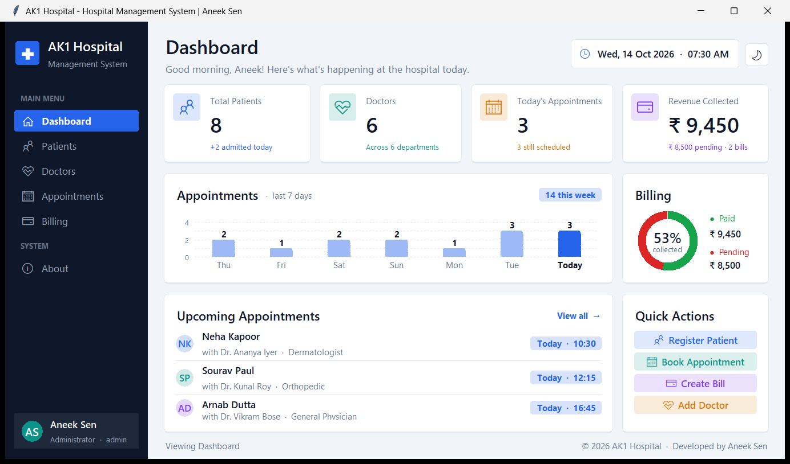
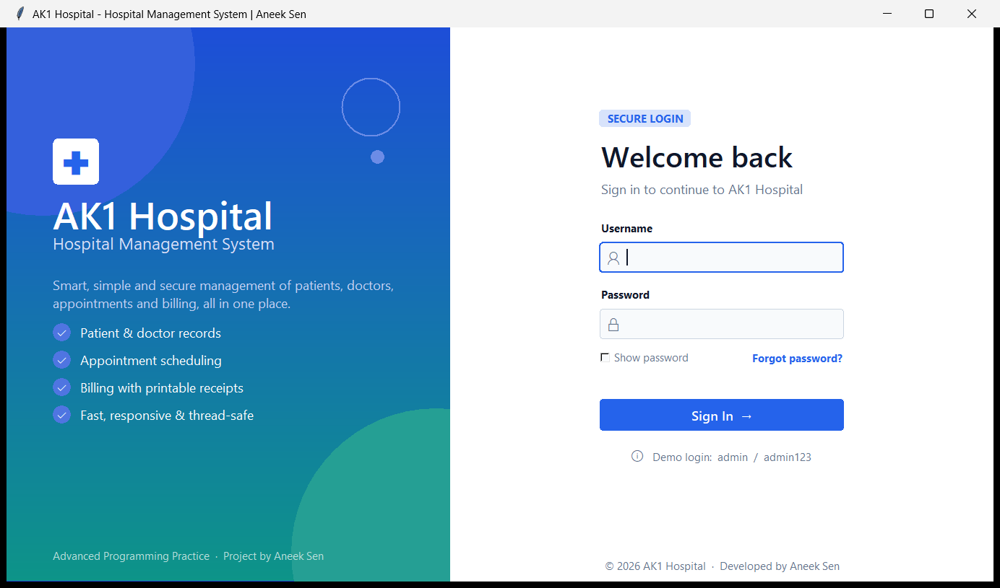
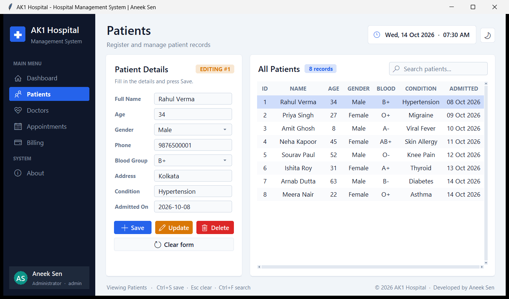
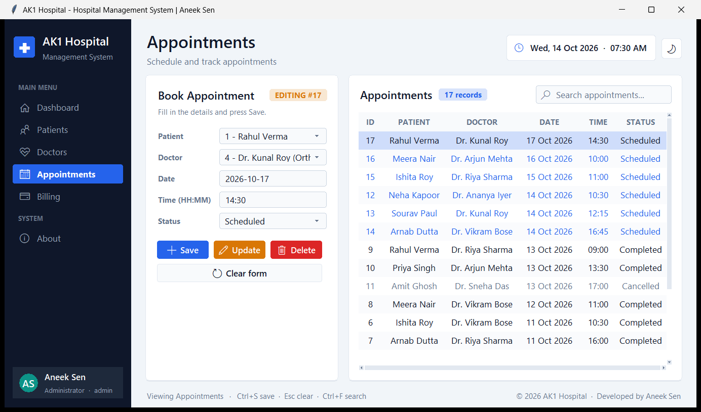
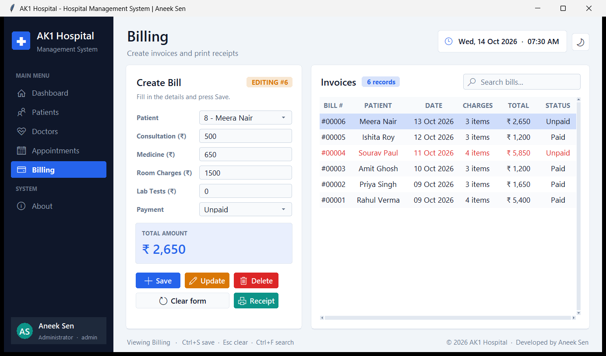
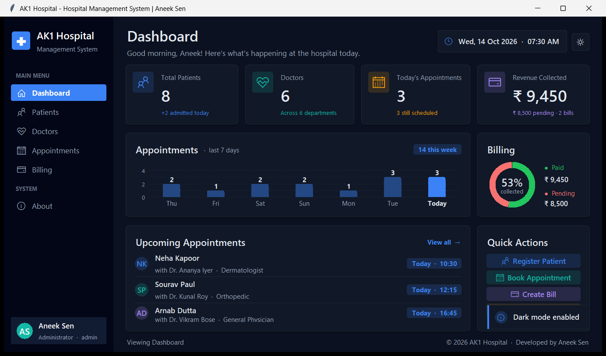
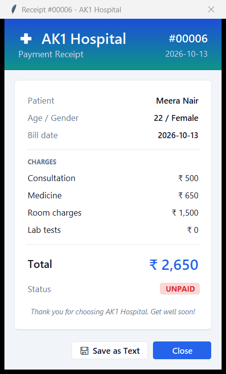

# AK1 Hospital – Hospital Management System

A modern desktop frontend for a hospital management system, built with **Python Tkinter**.
Advanced Programming Practice project (2nd Year) by **Aneek Sen**.

[](https://codespaces.new/senaneek03-pixel/AK1-Hospital-Management-System)
&nbsp; Run the app in your browser. See [Run it in your browser](#run-it-in-your-browser-github-codespaces).



## Screens

| Login | Patients |
|---|---|
|  |  |

| Appointments | Billing |
|---|---|
|  |  |

| Dark mode | Receipt |
|---|---|
|  |  |

More screenshots are in the [`screenshots`](screenshots) folder.

## Features

- **Splash and login screens** with a gradient design, show-password option and inline error messages
- **Dashboard** with animated stat cards, a 7-day appointments bar chart, a billing donut chart, upcoming appointments and quick actions
- **Patients, Doctors, Appointments and Billing** pages: add, update, delete and search records
- **Billing** shows a live total and prints styled receipts that can be saved as a text file
- **Light and dark themes** (your choice is remembered)
- **Slide-in notifications**, colour-coded statuses and row hover highlighting
- **Keyboard shortcuts:** `Ctrl+S` save, `Ctrl+F` search, `Esc` clear form
- **No UI freezing:** all database work runs on a background thread, and results come back to the Tk main thread through a queue polled with `after()`

## Run it

Requires **Python 3.8+** (Tkinter and SQLite come with Python, so there is nothing to install).

```bash
python ak1_hospital.py
```

Demo login: **admin / admin123**

On first run the app creates `ak1_hospital.db` with sample patients, doctors, appointments and bills.
The interface is designed for Windows (Segoe UI fonts and icons) and falls back to plain symbols on other systems.

## Run it in your browser (GitHub Codespaces)

No installation needed. You only need a GitHub account.

1. Click the green **Code** button, open the **Codespaces** tab and click **Create codespace on main**.
2. Wait 2–3 minutes while the codespace builds and installs Tkinter.
3. In the codespace **Terminal**, run:

   ```bash
   bash .devcontainer/run-app.sh
   ```

4. Open the **Ports** tab, find port **6080 (Desktop)** and click the globe icon to open it in a new browser tab.
5. Click **Connect**. The AK1 Hospital window is on the desktop. Log in with **admin / admin123**.

The `run-app.sh` script installs anything that is missing, so it also works in an older codespace.

Codespaces runs on Linux, so the app uses plain fonts and symbols instead of the Windows Segoe icons. Everything else works the same.
Codespaces uses your free monthly GitHub Codespaces hours; stop the codespace when you are done.

## Tech stack

Python 3 · Tkinter / ttk · Canvas graphics · SQLite · threading + queue · object-oriented design

## Project structure

```
ak1_hospital.py   # the whole application
screenshots/      # images of every screen
```

Inside `ak1_hospital.py`:

| Part | What it does |
|---|---|
| `Database` | SQLite on a worker thread; `run(job, on_done)` hands results back to the UI |
| `Card`, `RoundButton`, `Field`, `Pill`, `Gradient`, `Toast`, `NavItem` | Custom Canvas widgets for the modern look |
| `CrudPage` | Shared form + searchable table used by Patients, Doctors, Appointments and Billing |
| `DashboardPage`, `BarChart`, `Donut` | Dashboard and animated charts |
| `HospitalApp` | Splash, login, sidebar navigation, theme switching |

---
© 2026 AK1 Hospital · Developed by Aneek Sen
